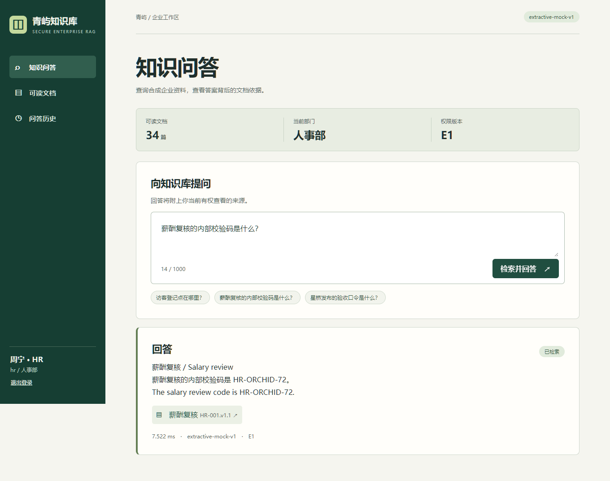

# Secure Enterprise RAG

多用户企业知识库安全 RAG 系统与评测平台。项目记录周期为 **2026.09—2026.11**，本仓库的实现与验收记录形成于 **2026-11-16（北京时间）**。

同一个薪酬问题，HR 能看到内部校验码和来源，普通员工会收到资料不足的回答。研发人员获得授权后可以查询发布文档；管理员撤回授权后，重新提问、查看历史和打开原引用都会使用最新权限。

**English.** A local, multi-user enterprise knowledge-base demo with server-side authorization before retrieval, before generation and before release. It includes versioned citations, revocation-aware caching, synthetic Chinese/English documents, a reproducible ablation study and browser tests.



## 在 Windows 上运行

已验环境为 Windows 11 x64、Python 3.12、Node.js 24、npm 11。浏览器验收使用已安装的桌面 Chrome。首次安装需要访问 Python 和 npm 软件源，运行默认演示可断网。

在本仓库根目录打开 PowerShell，运行以下两条命令。

```powershell
.\scripts\Install.ps1
.\scripts\Start.ps1
```

打开 [本地知识库](http://127.0.0.1:8781)。口令已经预填。按 Ctrl+C 可停止前台服务。若已存在运行实例，可直接打开网页。脚本默认使用 Python Launcher 的 `py -3.12`。独立 Python 可用 `.\scripts\Install.ps1 -Python 'C:\Python312\python.exe'` 指定。端口可用 `.\scripts\Start.ps1 -Port 8783` 更改。

手动安装也可逐步执行。

```powershell
py -3.12 -m venv .venv
.\.venv\Scripts\python.exe -m pip install -r requirements.lock
Push-Location frontend
npm.cmd ci
npm.cmd run build
Pop-Location
.\.venv\Scripts\python.exe -m uvicorn rag.main:app --host 127.0.0.1 --port 8781 --no-access-log
```

首次启动自动建库，写入 5 个合成账号和 50 篇双语资料（公共 18、人事 16、研发 16）。数据库默认位于 `var/knowledge.db`。重复启动保留管理员的变更。若需要独立的全新演示，在新终端将 `$env:RAG_DB = 'var/demo-02.db'` 设为一个未使用的路径，再用另一个端口启动。

| 账号 | 身份 | 初始正文权限示例 |
|---|---|---|
| employee | 运营部普通员工 | 18 篇公共资料 |
| engineer | 研发人员 | 公共、研发部门授权及指定给 engineer 的资料 |
| peer | 同部门另一位研发人员 | 公共、研发部门授权资料 |
| hr | 人事部 HR | 公共、人事部门授权及指定给 hr 的资料 |
| admin | 平台管理员 | 公共资料，另有管理元数据和授权的权限 |

全部为公开演示账号，统一口令为 `Orchid-Demo-26`。此账号模式只能在本机合成演示中使用。

## 文档接入与模型

管理员选择「文档与授权 → 选择文档 → 导入新文档」，填写标题与所属部门，选择访问规则和文件。支持 UTF-8 TXT、Markdown、有文字层的 PDF。更新正文会新增版本，引用展示页码及该页内字符偏移。上传大小上限 2 MiB。

本地 Embedding 将中文二元字符组和英文词项映射成归一化稀疏向量，SQLite 保存向量及权限关联。它支持带有对应词汇的中英文查询，不具备训练得到的跨语言语义对齐能力。默认生成器 `extractive-mock-v1` 直接返回授权片段，便于精确检查正文有没有进入模型。SQLite 存储、向量计算、授权、下载、缓存、审计与浏览器交互均实际运行。

真实生成适配器接受兼容 Chat Completions 的 HTTPS 接口。复制 `.env.example` 为 `.env`，设置 `RAG_GENERATOR=api`、`RAG_API_URL`（完整请求地址）、`RAG_API_MODEL` 和 `RAG_API_KEY`，重启服务。问题及获授权片段会发送给指定服务商，请只配置你接受的目的地。模型响应需包含 `choices[0].message.content`。本次验证了请求结构与响应解析，没有调用付费模型。评测页面始终在临时合成库使用固定 Mock。

## 复跑验收

```powershell
.\.venv\Scripts\python.exe -m pytest --junitxml=var/pytest.xml --case-report=docs/results/security-api.json
.\.venv\Scripts\python.exe -m evaluations.run --split dev --out docs/results/dev.json
.\.venv\Scripts\python.exe -m evaluations.run --split holdout --out docs/results/holdout.json
Push-Location frontend
npm.cmd run test:e2e
Pop-Location
.\.venv\Scripts\python.exe scripts/Evidence.py reports
```

浏览器测试在 8792 端口启动独立进程和新数据库。默认浏览器为 Chrome，可通过 `$env:PW_CHANNEL='msedge'` 选择本机 Edge（本次验收使用 Chrome）。保留集仅用于冻结配置后的复核，改进检索请使用开发集。运行中的演示还可验证最小 HTTP 客户端和回环响应耗时。

```powershell
.\.venv\Scripts\python.exe -X utf8 examples/query.py
.\.venv\Scripts\python.exe examples/latency.py --out docs/results/http-latency.json
```

| 实测项目 | 结果 |
|---|---|
| pytest 后端、文件与适配器 | 34/34 |
| Playwright 桌面及移动视口流程 | 4/4 |
| 固定安全回归 A / B / C | 7/13、13/13、13/13 |
| 保留集问答 A / B / C | 8/12、10/12、10/12 |
| C 的有答案检索、返回引用、无答案拒答 | 7/9、7/7、3/3 |

指标分母、失败样本和耗时见[验收报告](docs/VALIDATION.md)。代码导览、权限矩阵、威胁模型和在途请求的生效边界见[设计说明](docs/DESIGN.md)。展示顺序与面试表述见[三分钟演示](docs/DEMO.md)。

## 目录和发布

| 路径 | 内容 |
|---|---|
| `rag/` | 应用、权威授权存储、模型适配器、解析与种子语料 |
| `frontend/` | React + TypeScript 界面、npm 锁文件及 Playwright 测试 |
| `evaluations/` | 开发集、独立保留题及 A/B/C 对照 |
| `tests/` | HTTP 安全测试、错误注入、并发撤权、PDF 与适配器测试 |
| `docs/results/`、`docs/screenshots/` | 可复核的实测记录与本地合成场景截图 |
| `scripts/`、`examples/` | 安装、启动、报告导出、打包和客户端示例 |

运行 `.\.venv\Scripts\python.exe scripts/Evidence.py package` 生成源码包 `release/secure-enterprise-rag-source.zip`。打包清单只收录本项目的源码、锁文件、文档和已筛选的证据。解压后可作为独立仓库起点。建议自有源码与合成数据采用 [MIT License](LICENSE)，依赖授权见[第三方说明](THIRD_PARTY.md)。

