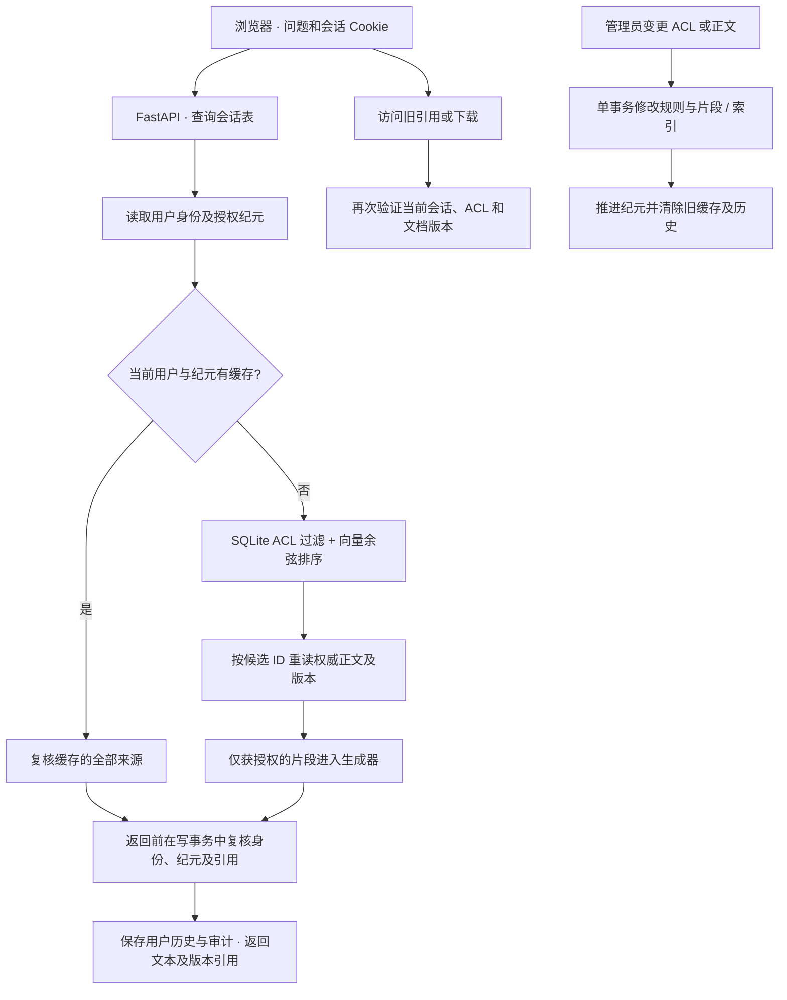

# 安全设计与代码导览

## 一次查询怎样到达生成器

| 模块 | 输入 | 输出及设计原因 |
|---|---|---|
| `rag/api.py`、`rag/store.py::identity` | 登录名、口令或随机会话 Cookie | 数据库中的 uid、角色、部门。Cookie 为 32 随机字节生成的令牌，库内保存 SHA-256 摘要及 8 小时有效期。口令按用户盐值进行 240,000 次 PBKDF2-HMAC-SHA256。切换账号及退出会废止原会话 |
| `rag/ingest.py`、`Store.index` | 合成文件字节、正文版本与规则版本 | 最大 420 字符的片段、60 字符重叠、页号、字符范围、标题加正文的向量。页号从 1 起算，偏移按 Python 字符计数，为左闭右开区间 |
| `Store.retrieve` 与 `Store.evidence` | 服务端身份、问题或候选 ID | SQL 先按当前规则及两类版本选候选，再按 cosine 排序。独立事务从权威表回读正文，即使候选 ID 被污染，未授权文本也到不了生成器 |
| `rag/adapters.py` | 查询文本或已授权证据 | 本地 Embedding 输出 65,536 桶的稀疏特征。生成适配器只接收问题、证据；真实接口无 tool 定义、数据库连接或授权写入口。来源由后端构造 |
| `rag/service.py::ask` | 会话令牌、问题 | 回答、文档 / 片段 ID、版本、缓存状态和耗时。检索、生成与最终交付分段，生成等待期间允许管理员提交撤权 |
| `rag/service.py::history` 与引用 / 下载路由 | 后端身份、当前纪元、版本化标识 | 所有读取重新验证。历史仅按账号获取最近 30 条，来源逐条复核。每次提问独立生成，历史不回灌模型 |
| `frontend/src/`、`evaluations/run.py` | API 结果或冻结的合成基准 | React 将自由文本作为文本节点呈现。评测入口重建独立临时数据，不读取演示数据库；不安全对照仅对自带合成副本执行 |

SQL 规则见 `rag/store.py::ALLOWED`，表与外键见 `rag/schema.sql`。每个片段持有 doc、version、acl_version。ACL 的明细保存在 grants 表，片段通过外键和版本关联继承它。管理员能查看管理目录中的标题、所有者、版本和规则，单独走正文授权接口才能取得文件或片段。

## 初始权限矩阵

✓ 为允许，— 为默认拒绝。全部资料均为虚构。

| 身份 | 公共 PUB-001 | 部门 HR-001 | 部门 RD-002 | 指定 engineer 的 RD-013 | 初始封存 RD-001 | 管理文档、ACL、审计、评测 |
|---|---|---|---|---|---|---|
| employee | ✓ | — | — | — | — | — |
| engineer | ✓ | — | ✓ | ✓ | — | — |
| peer | ✓ | — | ✓ | — | — | — |
| hr | ✓ | ✓ | — | — | — | — |
| admin | ✓ | — | — | — | — | ✓ |

公开、部门和个人 grant 按并集计算。撤销用户所有读取能力，需要移除所有仍匹配的授权路径。所属部门和上传者身份只属于文档元数据。没有公开标记且没有匹配 grant 时，管理员和所有者也不能读正文。账号列表与演示口令是公开合成数据。

## 版本、缓存和线性化点

- **文档版本**随正文更新递增。片段 ID 形如 `RD-001.v2.1`，下载也携带版本。旧版本的 URL、已删除的 ID 和无权的 ID 均返回统一 404。
- **规则版本**随文档 ACL 替换递增。文档与全部片段在同一事务更新这个版本。正文重建索引也在同一事务完成，解析失败会回滚。
- **全局授权纪元 epoch**在导入、授权修改、更新或删除时推进。事务同时清空 answers 表，其行同时承担历史与答案缓存。一次更改会清除所有用户的近期历史与缓存，这使撤权效果易于推导，代价是无关用户也会失去历史与命中。
- **缓存匹配**使用 uid、epoch、完整问题与模型 / 检索配置。每次命中仍会重查全部来源。查询文本与回答只在运行数据库的 answers 表保存，普通审计排除问答正文。
- **在途请求**以生成前的权威读取确定该次允许交给模型的上下文。生成结束后再开 `BEGIN IMMEDIATE` 写事务，检查当前会话、纪元及所有来源，写入回答和审计后提交。若撤权先于最终事务生效，响应为 409，退出时为 401，生成文本不交付。若最终事务先提交，这次响应已获准交付，网络到达的顺序可能不同。模型已经收到的上下文、已下载文件、复制内容及截图无法追溯收回。
- **浏览器残留**由 `Cache-Control: no-store`、账号切换清屏、聚焦及两秒一次的纪元复核降低。打开中的前台页面观察到新纪元后会重新取数。后台定时器受浏览器调度影响。服务端对每个新请求即时检查，视觉清屏不构成访问控制边界。

## 威胁模型及排除项

| 威胁或故障 | 已实现的控制 | 验证位置 |
|---|---|---|
| 浏览器伪造用户、部门或角色 | 会话反查、严格请求字段、服务端角色门禁 | `test_identity_forgery_and_csrf` |
| 猜测 ID、复制旧引用或下载链接 | 绑定当前主体，正文版本与规则版本均受校验 | `test_resource_matrix`、`test_full_lifecycle` |
| 脏索引、缓存串用、旧历史 | 候选仅为标识，正文重新授权；按主体缓存，变更事务清除历史 | `test_poisoned_candidate_never_reaches_model`、`test_cached_source_is_rechecked_and_history_fails_closed` |
| 生成过程中授权被撤销 | 短事务分段，返回前检查；多线程测试用事件精确控制时序 | `test_while_generation_in_flight` |
| 恶意资料含越权指令、脚本 | 生成器没有工具，后端独立授权，React 文本转义、CSP、附件下载 | `test_untrusted_text_inert_and_no_tool_access`、浏览器中检查实际 DOM |
| 授权、索引或生成服务失败 | 请求失败关闭，无不带过滤的降级查询。审计数据库故障也会阻断正常交付 | `test_fail_closed`；真实模型服务故障未做远端演练 |
| 跨站写请求 | SameSite=Strict、HttpOnly Cookie、写操作须带自定义头、同源静态资源、限定 Host | HTTP 负向测试。本机 HTTP 演示未启用 Secure Cookie |

模型可能误读被允许提供的材料、照抄注入文本或产生无依据的句子。无工具结构限制其可访问的数据，独立事实评测仍然必要。Mock 注入测试的结论只涉及授权隔离与文本呈现。

本地操作者、主机及数据库文件属于信任边界。数据库无静态加密，审计不是防篡改账本。拥有管理权限的人可以主动给自己授权，操作会留下审计记录；双人审批、企业 SSO、细粒度拒绝规则、限流、PDF 解析进程隔离、密钥托管及多节点事务均属后续工作。SQLite 的逻辑删除不等同于磁盘安全擦除。大规模索引和高并发吞吐未验证。

